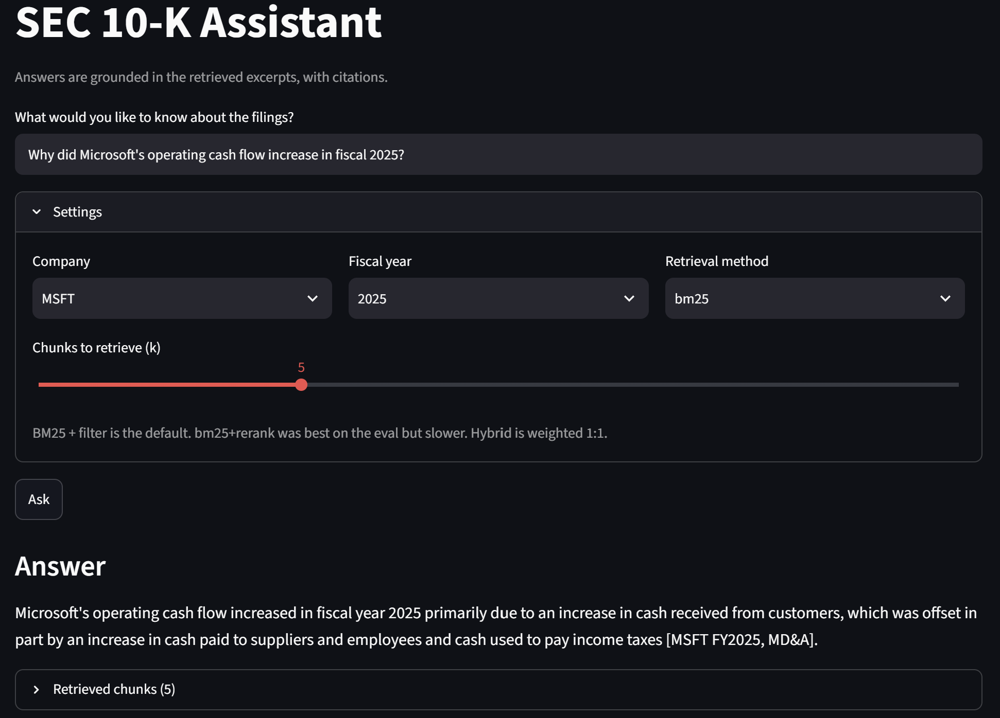

# SEC 10-K RAG Assistant

## Overview
A retrieval-augmented assistant that answers questions about SEC 10-K filings with cited, grounded answers. Evaluated on a 35-question benchmark, BM25 with a ticker/fiscal year metadata filter beat embedding search, while a BM25 followed by a cross-encoder reranker achieved the highest recall@5.

## Quick start
1. clone the repo, create a venv, `pip install -r requirements.txt`
2. copy `.env.example` to `.env` and add your `GEMINI_API_KEY`
3. run `streamlit run src/app.py`

The first launch is slow: it downloads the models and embeds the chunks into `data/chroma_db`. Later launches reuse stored embeddings, but still take some time to load the models.

## How it works
Parser (sec-parser) -> chunk (350 words, 75-word overlap) -> embed (bge-small, Chroma) + BM25 -> retrieve (optional rerank) -> Gemini answers from the excerpts only, with citations.
- The evaluation uses 35 questions across 9 filings from three companies (NVDA, AAPL, MSFT).
- Raw filings came from SEC EDGAR and were not committed.
- `chunked.json` is committed so parse and chunk steps don't run on launch.

## Results
### Baseline (filtered, k=5)
Recall@k measures whether the relevant evidence appears within the top-k retrieved chunks.
MRR (Mean Reciprocal Rank) measures how highly the first relevant chunk is ranked, with higher scores indicating that relevant evidence tends to appear earlier.

| Method | Recall@5 | MRR | Recall@30 |
|---|---|---|---|
| Vector | 22/35 (0.63) | 0.45 | 33/35 |
| BM25 | 29/35 (0.83) | 0.73 | 34/35 |
| Hybrid 1:1 | 28/35 (0.80) | 0.64 | 34/35 |
| Hybrid 1:2 (post hoc) | 31/35 (0.89) | 0.67 | 34/35 |
| BM25 + rerank | 32/35 (0.91) | 0.79 | n/a* |

\*Recall@30 for reranking was skipped since it was slow on CPU, and since it reorders BM25's top 30, its recall@30 cannot exceed BM25's (34/35).

Unfiltered, k=5: vector 17/35, BM25 26/35, BM25 + rerank 28/35.

### Findings
1. The metadata filter accounts for much of the gain. It lifts vector from 17 to 22 and BM25 from 26 to 29
2. BM25 beats vector by 7 questions and about 0.28 MRR at k=5
3. Vector does find the evidence but ranks it low
4. Reranker improves Recall@5 from 29/35 to 32/35. On BM25's top 30 it gained 4 questions and lost 1, at the cost of CPU latency.
5. Hybrid does not clearly help. 1:2 has a higher recall but lower MRR than BM25

### Grid Search
Chunk size (250 vs 350 words) and embedding models (bge-small vs gte-small) were varied, with overlap fixed at 75 words. Only vector and BM25 were run, filtered. `bge-small, 350` is the baseline re-run inside the grid.
| Config | Vector R@5 | Vector MRR@5 | Vector R@30 | BM25 R@5 | BM25 MRR@5 | BM25 R@30 |
|---|---|---|---|---|---|---|
| bge-small, 250 words | 20/35 (0.57) | 0.37 | 32/35 | 29/35 (0.83) | 0.74 | 35/35 |
| bge-small, 350 words (baseline) | 22/35 (0.63) | 0.45 | 33/35 | 29/35 (0.83) | 0.73 | 34/35 |
| gte-small, 250 words | 22/35 (0.63) | 0.42 | 31/35 | 29/35 (0.83) | 0.74 | 35/35 |
| gte-small, 350 words | 24/35 (0.69) | 0.51 | 31/35 | 29/35 (0.83) | 0.73 | 34/35 |

BM25 beat vector in every config, and was flat across chunk sizes. 350-word chunks performed better for vector retrieval than 250-word chunks for both embedding models. gte-small and bge-small showed no clear difference on this benchmark. No config clearly improves baseline, so default remains BM25 + metadata filter on 350-word chunks.

## Limitations
- 35 questions only
- Questions were written while reading the filings, so they share vocabulary with the evidence, which favours keyword matching. A natural-paraphrase set would test this.
- Chunks are sized in words rather than tokens, but token counts vary with content. About 14% of 350-word chunks exceed the 512-token input limit of the embedding models. This affects vector search only; BM25, reranking and answer generation use the full chunk text. Vector recall was lower at 250 words despite less truncation, so truncation does not appear to be the main driver of the vector gap, but this was not tested directly.
- Tables in filings were flattened with column boundaries lost. Simple tables with clear lead-in sentences were interpreted correctly in testing (e.g. Apple's net sales by product).
- Broad "summary" questions get only partial context from k chunks.
- Stateless Q&A, no multi-turn chat.

## Future Improvements
- User-provided SEC 10-K upload or fetch by ticker and fiscal year
- Token-aware chunking
- More natural-paraphrase evaluation set
- Multi-turn chat
